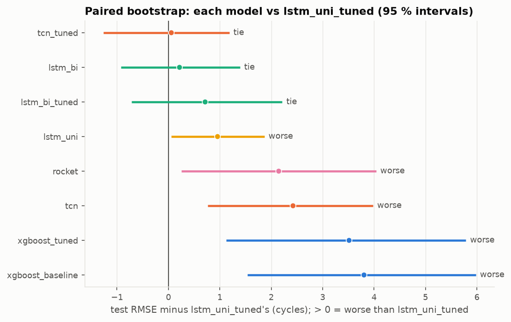
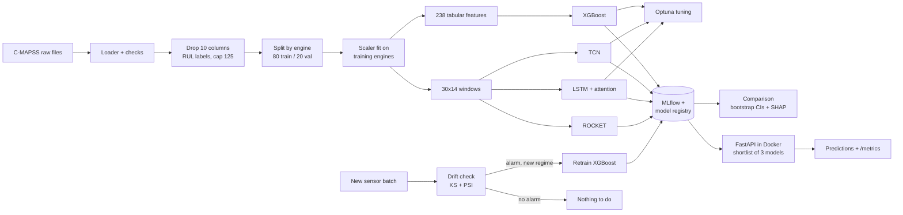
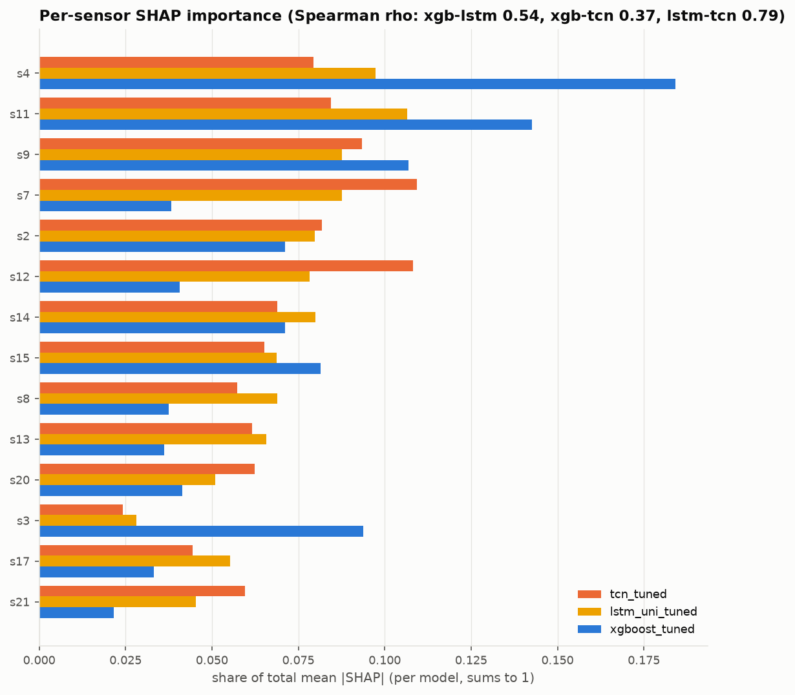
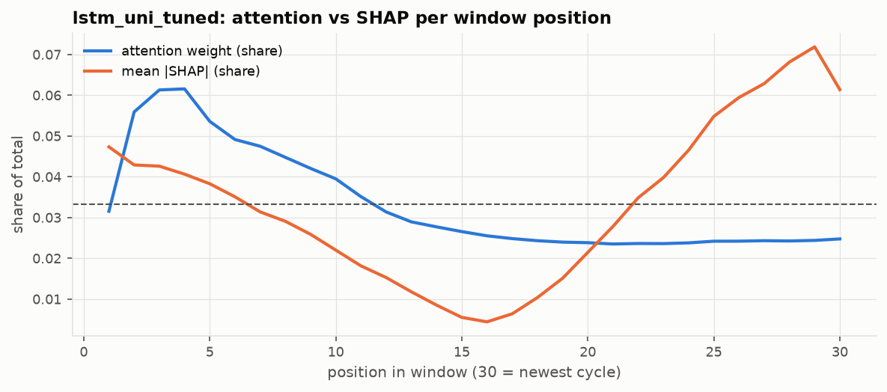
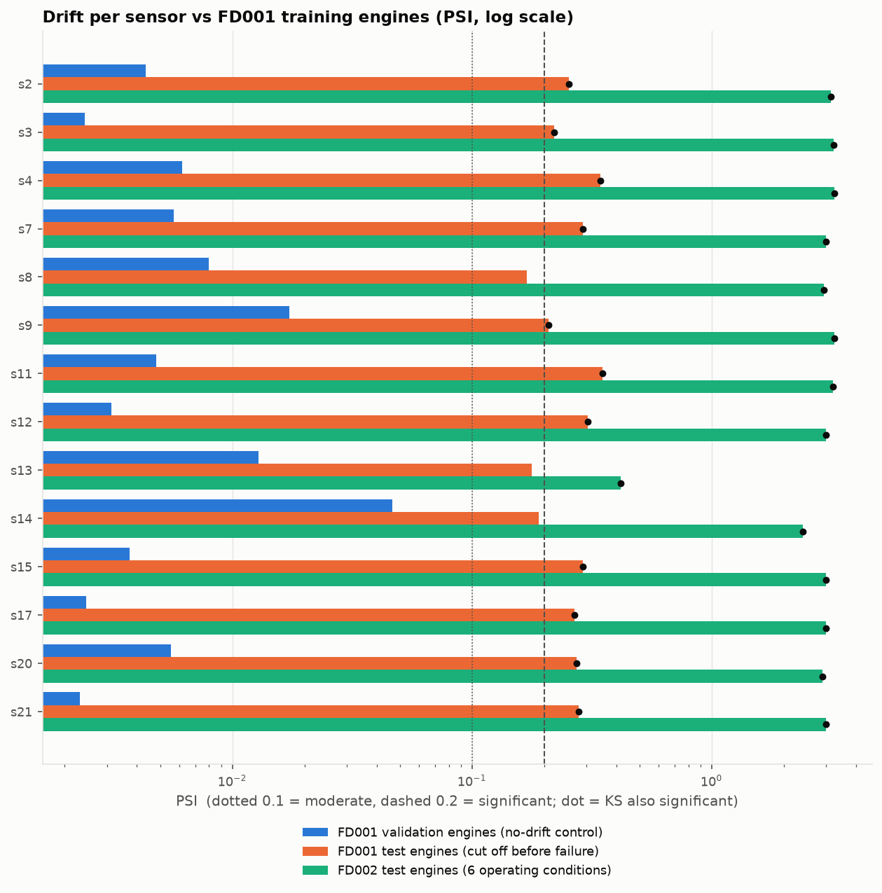

# Predictive Maintenance Pipeline — Turbofan Remaining Useful Life (NASA C-MAPSS)

    

An end-to-end ML engineering project: predict how many cycles a turbofan engine has left before failure from its
sensor history. It covers the full lifecycle — leakage-safe data pipeline, four model families, hyperparameter tuning,
experiment tracking, honest evaluation with uncertainty, explainability, drift detection with automated retraining,
and a containerised prediction API.

| | |
|---|---|
| **Data** | NASA C-MAPSS FD001 (100 training engines run to failure, 100 test engines cut off before failure, 14 informative sensors). FD002 (six operating conditions) for the drift demo. |
| **Models** | XGBoost on 238 engineered features · TCN · LSTM with attention (bidirectional and unidirectional) · ROCKET (MiniRocket + ridge) |
| **Engineering** | Optuna · MLflow + model registry · bootstrap confidence intervals · SHAP · KS/PSI drift detection + retraining trigger · FastAPI · Docker · Prometheus metrics · 131 tests |

---

## Results (FD001 test set, 100 engines)

All models follow one protocol: the same 80 training / 20 validation engines, a scaler fit on training engines only,
and one prediction per test engine from its last 30 cycles. Intervals: 95 % bootstrap over the test engines (10,000
resamples). "Tie" = the paired bootstrap difference to the best model includes 0.

| Model | Test RMSE [95 % CI] | NASA score | RMSE (truth capped at 125)¹ | vs best | Params | Latency² |
|---|---|---|---|---|---|---|
| **lstm_uni_tuned** | **14.25** [11.9, 16.5] | **321** | **12.91** | best (point) | 387 k | 2.7 ms |
| tcn_tuned | 14.30 [11.9, 16.6] | 324 | 12.97 | tie | 141 k | 3.2 ms |
| lstm_bi | 14.46 [12.1, 16.7] | 355 | 13.27 | tie | 90 k | 1.8 ms |
| lstm_bi_tuned | 14.96 [12.4, 17.5] | 476 | 13.96 | tie | 2.72 M | 7.5 ms |
| lstm_uni | 15.20 [12.8, 17.6] | 400 | 13.89 | worse | 37 k | 1.3 ms |
| rocket | 16.39 [14.2, 18.4] | 425 | 14.93 | worse | 10 k³ | 1.5 ms |
| tcn | 16.67 [13.9, 19.3] | 521 | 15.35 | worse | 32 k | 2.6 ms |
| xgboost_tuned | 17.76 [14.7, 20.7] | 671 | 16.50 | worse | 521 trees | 1.3 ms |
| xgboost_baseline | 18.05 [15.1, 20.9] | 681 | 16.85 | worse | 139 trees | 1.0 ms |
| *predict the training mean (no skill)* | *43.00* | *32,772* | *41.86* | | | |

¹ Many papers also cap the test truth at 125; use this column to compare with them. Our primary metric uses NASA's
truth as given, under which even a perfect capped model scores RMSE 3.74.
² Median CPU time of `model.predict` for one engine on a laptop (Intel i7-7600U, 4 threads). A full API request adds input
preparation: ~5 ms total for the deep models, ~44 ms for XGBoost (its 238 features), measured in the container.
³ Ridge weights on 9,996 random-kernel features; the kernels themselves are not trained.



Full table: [`results/model_comparison.csv`](results/model_comparison.csv) · notebook
[`03_Results_and_Comparison`](notebooks/03_Results_and_Comparison.ipynb).

## Key findings

1. **Four deep models are statistically tied for first** (paired bootstrap). With only 100 test engines, a 0.05–0.7
   cycle gap is noise, so no single winner is claimed.
2. **Deep models on raw 30-cycle windows beat XGBoost on hand-engineered features**: +3.5 RMSE [+1.1, +5.8] for the
   tuned XGBoost — the most robust result.
3. **Bidirectionality brings no measurable benefit**: the unidirectional LSTM matches it with 7× fewer parameters and
   works on a live stream.
4. **Tuning can overfit the validation set**: `lstm_bi_tuned` had the best validation score of all LSTMs but the worst
   test score of the tuned deep models, behind even its untuned version (50 trials selected on 20 validation engines).
   Tuning gave XGBoost only −1.6 %.
5. **ROCKET is competitive without a GPU or a tuning study** (16.39), but it is not "300× faster within 5 %": 90 % of
   its 97 s training time is the ridge solve over ~10,000 features.
6. **Models agree on the degradation signal.** SHAP puts sensors s11 and s9 in every model's top 5; the correlated group
   s4/s7/s11/s12 carries ~40 % of the importance in XGBoost, the LSTM and the TCN alike.
7. **Attention is not explanation**: the tuned LSTM's attention gives the newest 8 cycles 19 % of its weight (less than
   uniform), while SHAP says those cycles carry 46 % of the effect.
8. **Drift detection fires when it should, and only then**: no alarm on held-out FD001 engines, a large alarm on FD002
   (median PSI 3.0). The best FD001 model scores 63.6 RMSE on FD002 — worse than predicting a constant (54.1) — and
   drift-triggered retraining brings XGBoost from 48.1 to 30.4 (18.3 against capped truth, the floor there).
9. **An alarm is not proof of harm**: FD001's own test engines also trigger it (they were stopped before failure, so
   their readings are mostly healthy), yet every model scores normally on them.

Details and the reasoning behind every choice: [`docs/EXPERIMENTS.md`](docs/EXPERIMENTS.md) (E1–E10) and
[`docs/DECISIONS.md`](docs/DECISIONS.md).

## Architecture



## Explainability

| | |
|---|---|
|  |  |
| Per-sensor SHAP importance, three models ([`04_SHAP`](notebooks/04_SHAP.ipynb)) | Attention weights vs SHAP per window position ([`05_Attention`](notebooks/05_Attention.ipynb)) |

## Drift detection and retraining

A sensor drifts if the KS test is significant (p < 0.05) **and** the Population Stability Index exceeds 0.2; an alarm
needs at least 3 drifting sensors. KS alone flags harmless differences at these sample sizes, so the effect-size
condition is required.

| Batch vs FD001 training engines | Drifting sensors | Median PSI | Alarm |
|---|---|---|---|
| FD001 validation engines (control) | 0 / 14 | 0.005 | no |
| FD001 test engines (stopped before failure) | 11 / 14 | 0.27 | yes — harmless |
| FD002 test engines (6 operating conditions) | 14 / 14 | 3.00 | yes |



`scripts/retrain_if_drift.py` is meant to run on a schedule (e.g. a daily cron job): no alarm → nothing; alarm on the
model's own data regime → flagged for review; alarm on a new regime → retrain, register (`retrained_after_drift`), and
store the new regime as the reference. Notebook: [`06_Drift_and_Serving`](notebooks/06_Drift_and_Serving.ipynb).

## Prediction API

Serves `lstm_uni_tuned` (default), `tcn_tuned` and `xgboost_tuned`; the client chooses per request. Input: an engine's
**raw** readings, one row per cycle with the 24 values `[op1, op2, op3, s1 … s21]`. The server applies the training
pipeline itself, and reproduces all 300 official test predictions exactly.

| Endpoint | |
|---|---|
| `GET /health` | liveness and loaded models |
| `GET /models` | the served models with their test metrics |
| `GET /metadata?model=` | registry row and bundle metadata |
| `POST /predict?model=` | predicted RUL (default model if omitted) |
| `POST /predict/compare` | the same engine through every served model |
| `GET /metrics` | Prometheus: prediction count, errors, latency per model, live drift score |

```bash
docker build -t pm-api .
docker run --rm -p 8000:8000 pm-api          # interactive docs: http://localhost:8000/docs
curl -X POST "http://localhost:8000/predict" -H "Content-Type: application/json" -d @scripts/sample_request.json
# Windows PowerShell: use curl.exe and quote the file: -d "@scripts/sample_request.json"
```

`scripts/sample_request.json` is FD001 test engine 76 (true RUL 10); the default model answers 8.0.

## Reproducing

Python **3.12** is required (MLflow and Optuna do not install on newer versions yet).

```bash
python -m venv venv && venv/Scripts/activate        # Linux/macOS: source venv/bin/activate
pip install -r requirements.txt
```

1. **Data**: follow [`data/data_manifest.txt`](data/data_manifest.txt) (Kaggle `behrad3d/nasa-cmaps` via kagglehub,
   checksums in `data/sha256sums.txt`).
2. **Train** (models are written to `trained_models/`, runs to MLflow, one row each to `trained_models/model_registry.csv`):
   ```bash
   python -m src.train_xgboost                                    # baseline
   python -m src.train_xgboost_optuna                             # 100 trials -> xgboost_tuned
   python -m src.train_rocket
   python -m src.train_tcn_optuna                                 # deep models: GPU recommended,
   python -m src.train_lstm_optuna --variant uni                  # see docs/COLAB.md for Colab
   ```
3. **Analyse**: `python -m scripts.compare_models`, `python -m scripts.shap_analysis`, `python -m scripts.simulate_drift`,
   `python -m scripts.retrain_if_drift --batch FD002-test --dry-run`.
4. **Serve**: `uvicorn src.api.main:app --port 8000`, or the Docker commands above (the image copies the trained
   bundles, so train first).
5. **Test**: `python -m pytest` (131 tests; API tests that need trained weights are skipped without them).
6. **Inspect runs**: `mlflow ui --backend-store-uri sqlite:///mlflow.db`.

## Repository layout

```
src/            pipeline code: data_loader, feature_engineering, evaluation, models/, training scripts,
                comparison, explain, monitoring, drift_data, api/
scripts/        compare_models, shap_analysis, simulate_drift, retrain_if_drift, import_colab_outputs, sample request
notebooks/      01_EDA · 02_Feature_Engineering · 03_Results · 04_SHAP · 05_Attention · 06_Drift_and_Serving
                (showcase only: they import from src/) · colab_train (GPU training)
configs/        tuned hyperparameters, serving shortlist
results/        figures and tables (committed)
docs/           DECISIONS, EXPERIMENTS, DEVIATIONS, COLAB, planner
tests/          pytest suite
```

## Caveats

- **Test truth is not capped.** Scores use NASA's `RUL_FD001.txt` as given; papers that cap it at 125 report lower
  numbers — compare those with the clip125 column.
- **Small test set.** 100 engines give confidence intervals of about ±2.3 RMSE; rankings inside the top group are not
  meaningful.
- **The bidirectional LSTM** reads each 30-cycle window in both directions. That is valid for a fixed past window but
  not for cycle-by-cycle streaming; the unidirectional LSTM and the TCN are causal.
- **Hardware.** Deep models trained on a Colab T4 GPU, XGBoost and ROCKET on a laptop CPU; training times are not
  comparable across the two. All latencies were measured on the same laptop CPU.
- **Drift demo.** FD002 is used without operating-condition normalisation, and its test split serves as both the
  incoming batch and the evaluation set. The retrained model's reference assumes the fleet has moved to the new regime.

## Future work

- Benchmarks on FD002–FD004 (multiple operating conditions and fault modes), with operating-condition normalisation.
- Per-operating-condition drift monitoring for mixed fleets.
- Incremental per-engine feature state in the API (removes XGBoost's feature-building cost).
- ROCKET kernel-count vs accuracy/speed curve.

## References

- A. Saxena, K. Goebel, D. Simon, N. Eklund. *Damage Propagation Modeling for Aircraft Engine Run-to-Failure Simulation.* PHM 2008.
- S. Bai, J. Z. Kolter, V. Koltun. *An Empirical Evaluation of Generic Convolutional and Recurrent Networks for Sequence Modeling.* 2018 (TCN).
- D. Bahdanau, K. Cho, Y. Bengio. *Neural Machine Translation by Jointly Learning to Align and Translate.* ICLR 2015 (attention).
- A. Dempster, D. F. Schmidt, G. I. Webb. *MiniRocket: A Very Fast (Almost) Deterministic Transform for Time Series Classification.* KDD 2021.
- S. M. Lundberg, S.-I. Lee. *A Unified Approach to Interpreting Model Predictions.* NeurIPS 2017 (SHAP).
